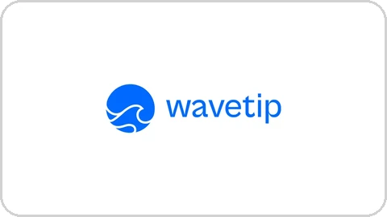

<picture>
  <source media="(prefers-color-scheme: dark)" srcset="./assets/name-dark.svg">
  
</picture>

**Backend Software Engineer at [Riot](https://tryriot.com).** I build and ship production software end to end, from Elixir services and PostgreSQL to Rust data pipelines and agentic AI workflows.

 

## Experience

**Riot** 
Backend Software Engineer · 2026 – present · Paris

Riot helps companies secure their teams against cyberattacks. I work on Inbox, the 24/7 AI-powered hotline where employees report suspicious emails, and on Slash, which warns them inside those emails and removes confirmed threats from every mailbox.

- Built the email that tells employees when a message they clicked “Looks safe” on turns out to be fraudulent: verdict triggers and Oban jobs in Elixir, and a React template in 34 locales.
- Rewrote the automated replies to employees who report a suspicious email: when no analyst has reviewed it yet, they say what the analysis found instead of giving a verdict, and they always tell the reporter not to interact with a malicious email.
- Added an attack-type filter to the Inbox ticket list, backed by a partial PostgreSQL index built without blocking writes.

**Lobster Protocol** 
Full-Stack Software Engineer · 2025 – 2026

- Designed and deployed a Rust job scheduler orchestrating on-chain PnL and liquidity metrics pipelines.
- Built and shipped an internal production dashboard with backend caching and observability using Prometheus, Grafana and Loki.
- Redesigned an internal access-management platform around REST APIs, session management and RBAC.
- Developed a multisig connector service for blockchain transactions.

## Startups

**Legimens** 
Co-founder & CTO · 2026

Built a production Claude Skill that runs end-to-end GEO audits for enterprise clients: a resumable 13-phase agentic workflow with state management, multi-agent review, deterministic validation gates and automated PDF and XLSX reports.

**WaveTip** 
Co-founder & CTO · 2025 – 2026

A Chrome extension for native RLUSD tipping on Twitch, live on the Chrome Web Store and the XRPL Mainnet. I built the XRPL wallet onboarding: wallet provisioning, trustlines, encrypted key storage and Xaman QR funding. Selected for UC Berkeley’s Digital Assets Xcelerator with Ripple.

## Hackathons

| | Project | Result |
|:--|:--|:--|
|  | **[WaveTip](https://wavetip.vercel.app)** Native RLUSD tipping on Twitch | 🥇 **1st place**, XRPL Mainnet Track EasyA × Ripple APEX · Singapore |
|  | **[Vale](https://github.com/KyllianGenot/Vale)** Zero-interest DeFi lending | 🥇 **1st place**, Tokenized Validators Track Kiln Hackathon · Paris |
|  | **[RippleTip](https://github.com/KyllianGenot/RippleTip)** Discord tipping bot using RLUSD on the XRP Ledger | 🥈 **2nd place**, RLUSD Track ETHDenver · Denver |
|  | **[decID](https://github.com/KyllianGenot/decID)** Privacy-focused decentralized identity on XRPL | 🥈 **2nd place** Italian XRPL Hackathon · Rome |

## Stack

<picture>
  <source media="(prefers-color-scheme: dark)" srcset="./assets/stack-dark.svg">
  
</picture>

## Education

**ESILV** · Engineering, Fintech & UX Design · Class of 2026
